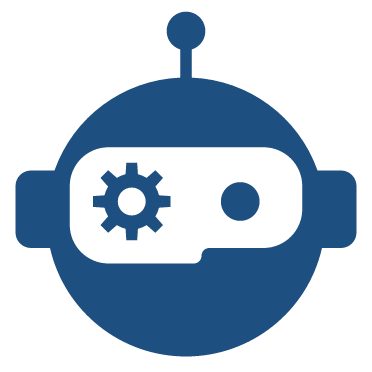
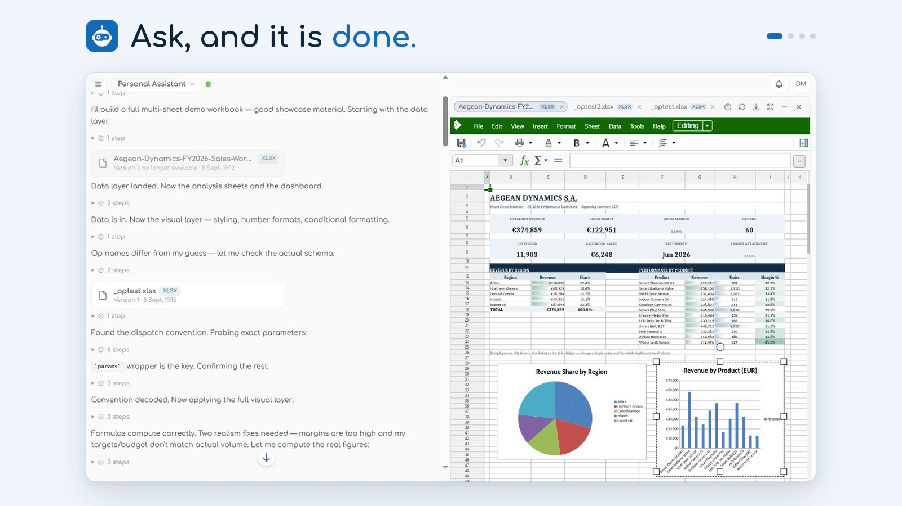
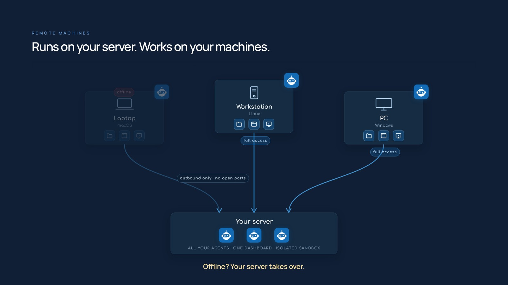
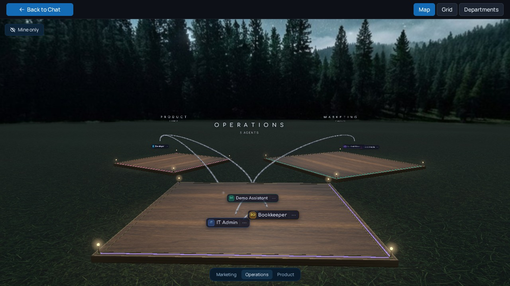
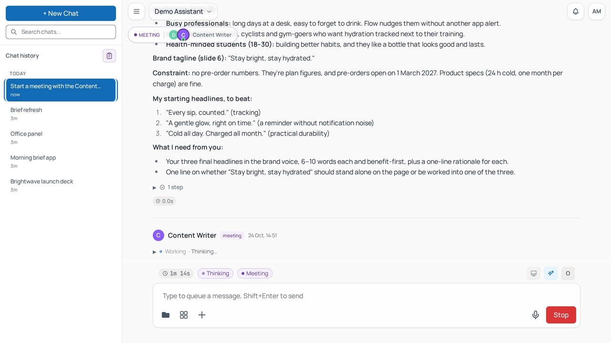
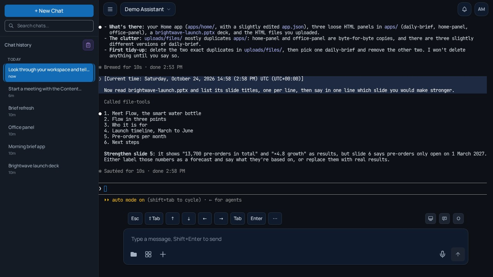
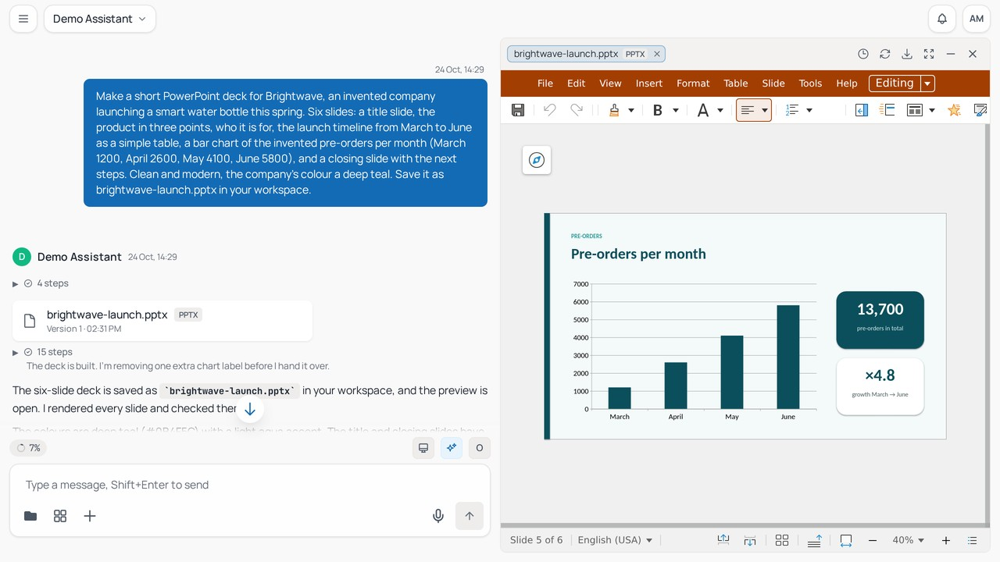

<p align="center">
  <picture>
    <source media="(prefers-color-scheme: dark)" srcset=".github/media/logo-mark-white.png" />
    
  </picture>
</p>

<p align="center"><b>OtoDock · Collaborative Agents</b></p>

<h1 align="center">The self-hosted platform for your company's AI agents.</h1>

<p align="center">
Your team builds them on Claude Code, Codex or local models, and they work in
chats, on schedules, on the phone and on your own machines.
</p>

<p align="center"><b>The agentic company OS.</b></p>

<p align="center">
  <a href="LICENSE"></a>
  
  <a href="https://github.com/OtoDock/oto-dock/actions/workflows/ci.yml"></a>
  <a href="https://docs.otodock.io"></a>
  <a href="https://otodock.io"></a>
</p>

<p align="center">
  <a href="#quick-start">Install</a> ·
  <a href="#the-two-minute-video">Video</a> ·
  <a href="https://docs.otodock.io">Docs</a> ·
  <a href="https://otodock.io">Website</a> ·
  <a href="https://otodock.io/features">Features</a> ·
  <a href="https://github.com/OtoDock/oto-dock/discussions">Discussions</a> ·
  <a href="https://x.com/otodock">X</a> ·
  <a href="https://www.linkedin.com/company/otodock">LinkedIn</a>
</p>

<p align="center">
  <a href="#the-two-minute-video"></a>
</p>

<p align="center"><em>Dashboard highlights. <a href="#the-two-minute-video">Watch the two-minute video</a>, made by an OtoDock agent.</em></p>

---

## Why OtoDock

OtoDock acts as the brain of your company. You create powerful agents that
connect to the tools your company runs on, work in departments, delegate to
each other, and keep working on their own when no one is watching. Your
agents can build and deploy internal apps for your team, or even public ones
you share with your customers.

OtoDock is multi-tenant by design. Many people work with the same agents,
and four modes decide how an agent is shared and where its work lands. You
work with your agents on your self-hosted dashboard, or you can even give
them a phone line and talk to them. All of it runs on your own Anthropic and
OpenAI subscriptions, and on local models.

OtoDock is built, tested and shipped by agents running on OtoDock.

## Quick start

You need a Linux server (x86-64 or arm64) with Docker Engine 26 and Docker
Compose 2.26 or later, or a Mac with Apple silicon and Docker Desktop, with
at least 4 GB of RAM
([sizing](https://docs.otodock.io/getting-started/installation#how-much-ram))
and about 13 GB of free disk, plus a Claude or ChatGPT subscription, an API
key or a local model server. Then, in its own folder:

```bash
mkdir otodock && cd otodock
curl -fsSLO https://raw.githubusercontent.com/OtoDock/oto-dock/main/scripts/install.sh
bash install.sh
```

The script does fresh installs only, and `scripts/upgrade.sh`
[upgrades](https://docs.otodock.io/administration/upgrading) one later. The
[installation guide](https://docs.otodock.io/getting-started/installation)
covers the rest: the server's address, HTTPS behind a reverse proxy, the
phone service and building from source.

Then open **http://localhost:8400**, or your server's address on port 8400,
and the setup wizard greets you. Create the owner account, and OtoDock
installs the Personal Assistant for you, with the tools it needs. Connect
your Claude or ChatGPT subscription under Setup, AI Engines. Then open the
Personal Assistant from the Agents page and send it your first message
([first run](https://docs.otodock.io/getting-started/first-run)). From there
you add agents from the community catalog or build your own, and you add the
people who will work with them.

## Build your own AI agents

Every agent is a digital employee you give a job. It has its own knowledge,
workspace, skills and tools. The
[Agents page](https://docs.otodock.io/concepts/agents) in the docs explains
each part.

## Four ways to share one agent

Every agent has a mode that decides how people share it, and where its
workspace lives: private for each person, shared by the whole team, or both.

| Mode | What it means |
|---|---|
| **Personal only** | A private workspace for each person. |
| **Personal + shared** | A private workspace for each person as the default, and a shared one for the team. |
| **Shared + personal** | A shared team workspace as the default for everyday work, plus a private one per person. |
| **Shared only** | Everyone shares one history and one workspace. |

## Everyone gets the right seat

Each person has a role on every agent they use. The role decides what they
can see and do there. Admins add each person to the agents they need.

| Three platform roles | Four roles on every agent |
|---|---|
| An **Admin** runs the platform. | A **Manager** has full control of the agent. |
| A **Creator** creates agents. | An **Editor** edits the shared files and automates as the agent. |
| A **Member** uses the agents they are given. | A **Contributor** adds files to the shared workspace, nothing more. |
| | A **Viewer** chats and reads the shared files. |

## Claude Code or Codex on your subscription, or local models.

Claude Code runs on your Anthropic subscription, and Codex runs on your
ChatGPT subscription. Every user connects their own subscription or API key,
or an admin shares theirs with the team.

Local models on your own hardware work as well, through Ollama or any
OpenAI-compatible server. You pick the engine per agent, and you can switch
it per chat ([AI engines](https://docs.otodock.io/concepts/ai-engines)).

## They work while you are away

Agents run on any schedule, when a webhook event fires, or once at a time
you choose. They work in your workspace, where their reports and files land.
They notify you when something needs you, from a quiet chime to a persistent
danger alarm ([tasks](https://docs.otodock.io/features/tasks),
[triggers](https://docs.otodock.io/features/triggers)).

Every run is a full chat you can open, read and continue. The checks you
attach judge the work at the end of a turn, and send the agent back for
another round when it falls short
([checks](https://docs.otodock.io/features/checks)).

## Runs on your server. Works on your machines.

The same agent, with the same files and tools, moves to any of your
computers and keeps working there. By default, all your agents run on your
server, in an isolated sandbox, with one dashboard controlling all of them.
On your computer, the agent has full access to the machine, and you still
work with it from the same dashboard, anywhere.

You pair a laptop, a workstation or a PC running macOS, Linux or Windows
with a one-line install. The machine keeps a single outbound connection to
your server, so it needs no open ports, and its files stay in sync. If the
machine goes offline, your server takes over
([remote machines](https://docs.otodock.io/remote-machines/overview)).

<p align="center">
  
</p>

<h3 align="center">Your own cloud of agents.</h3>

## Build and deploy full apps, just by asking your agent.

An agent can build and deploy its own apps. An app is a page with its own
address, so you can bookmark it and come back to it any time. It can have
buttons that put the agent to work, show live data from the platform and,
when it needs one, run its own server and database.

- **Apps for you or your team.** They live inside OtoDock, on the agent. A
  developer agent can keep an app that shows your GitHub issues, pull
  requests and builds at a glance, or a project board where a button on a
  card hands the work to the agent.
- **Apps for your customers.** A public link opens the app for anyone, with
  no OtoDock account. Think of a hairdresser's booking page: clients open
  the link, pick a time and pay.

You can share an app or a chat with a teammate, place an app in another
agent's or a whole department's apps, where that agent's chats and tasks
call what the app offers, or share either with anyone by a link
([apps](https://docs.otodock.io/features/apps)).

## Give an agent a phone number

Agents answer and place phone calls, and hand a caller over to you or a
colleague when the conversation needs a person. Bring your own Twilio
account, or connect the Asterisk or FreePBX server you already run
([phone](https://docs.otodock.io/features/phone)).

## The two-minute video

https://github.com/user-attachments/assets/743de1c6-e582-42f6-9996-cde277befbf2

<p align="center"><em>This entire video was directed, captured and edited by an OtoDock agent.
<a href="https://otodock.io">Watch it in full quality on otodock.io</a>.</em></p>

## The company, running

<table>
  <tr>
    <td width="50%"></td>
    <td width="50%"></td>
  </tr>
  <tr>
    <td><b>Departments.</b> Organize your agents into departments. A department's delegation mode decides who can hand work to whom: <b>Down only</b>, <b>Down and across</b>, <b>All directions</b> or <b>Off</b>.</td>
    <td><b>Meetings.</b> Specialist agents discuss a topic together and converge on an answer, live in the dashboard.</td>
  </tr>
  <tr>
    <td></td>
    <td></td>
  </tr>
  <tr>
    <td><b>Terminal.</b> The Claude Code or Codex terminal opens in the dashboard, with the agent's tools already loaded.</td>
    <td><b>Documents.</b> They edit Excel, Word and PowerPoint files right in the chat.</td>
  </tr>
</table>

## Locked down by default

OtoDock assumes agents cannot be trusted ([the security
model](https://docs.otodock.io/security/overview), [SECURITY.md](SECURITY.md),
the [advisories](https://github.com/OtoDock/oto-dock/security/advisories)).

- **A kernel sandbox around every agent on the server.** Each session has its
  own mount and process namespace and sees only the folders its user's role
  allows.
- **Network isolation, always on.** From the sandbox, private ranges, your LAN
  and cloud metadata endpoints are unreachable, and a tool that needs one
  internal service gets a path to that host alone.
- **Secure credentials.** Credentials saved in the database are encrypted.
  Your chats run on your own AI and connected accounts, or on a shared key
  your admin allows. git and gh fetch a connected GitHub account's token per
  command, so it sits in no file or environment variable. A manager can narrow
  what an agent does on GitHub to chosen repositories, or to reading. Anyone
  can do the same with their own GitHub account, agent by agent.
- **Ready for teams.** SSO sign-in, two-factor auth, and per-user cost
  budgets come standard, from the first install.
- **Releases you can verify.** Images are built on GitHub from this
  repository, booted before they get their version tag, and carry a signed
  provenance and a software bill of materials. A confirmed vulnerability gets
  an advisory and a CVE request.

## Everything included

One platform, the whole toolkit.

- **Memory that persists.** Agents keep transparent, editable memory files,
  per user and per agent.
- **Documents and files.** Agents create and edit Word, Excel, PowerPoint
  and PDF files, and every file opens in a live editor inside the chat.
- **Images.** Agents generate and edit images in the chat, and a
  professional-grade pipeline handles photo editing.
- **Video and audio.** Agents generate footage and transitions, cut
  timelines, add captions, voice-overs and music, transcribe audio and video
  into text and subtitles, and produce speech and music of their own.
- **Web browsing.** The anti-detect browser tool from the community catalog
  lets agents research the live web.
- **Built-in tools.** Schedules, triggers, notifications, checks, meetings,
  delegation, phone calls, file transfer between agents, live charts and
  apps, SSH hosts, and browser and computer control on paired machines
  all ship with the platform.
- **Community catalog.** Ready-made agents, tools and skills install in one
  click, with GitHub, Notion, Home Assistant, Nextcloud, Prometheus, UniFi
  and Uptime Kuma among them, and many more landing regularly. Agent
  templates arrive with their apps and checks, and follow new versions.
- **Extensible by design.** Any MCP tool server installs from a manifest,
  and tools are assigned per agent.
- **Usage and budgets.** Costs are tracked per user and per agent, with
  weekly or monthly limits.
- **Team-ready security.** SSO and OIDC, two-factor auth, per-agent roles,
  encrypted credentials and scoped API keys come from day one.

See all features at [otodock.io/features](https://otodock.io/features).

## How it fits together

```
 proxy/       The platform core (FastAPI): sessions, security, scheduling,
              the agent sandbox and the WebSocket hub the dashboard talks to
 dashboard/   The React dashboard, and android/ wraps it in the Android app
 mcps/        The first-party MCP tool servers and the community mirrors
 audio/       The speech package: speech to text, text to speech, voice activity
 phone/       The phone service: live calls over Twilio or Asterisk and FreePBX
 satellite/   The remote-machine agent that pairs your own hardware
 scripts/     Install, compose, backup and restore, maintainer tooling
```

On the server, agents run inside per-session sandboxes as Claude Code or Codex
processes or on the direct engine, use their tools over MCP and stream every
step to the dashboard, and PostgreSQL holds the state.
[ARCHITECTURE.md](ARCHITECTURE.md) maps the code,
[CONTRIBUTING.md](CONTRIBUTING.md) covers the setup and the tests,
[AGENTS.md](AGENTS.md) instructs coding agents, and
[satellite/README.md](satellite/README.md),
[satellite/PROTOCOL.md](satellite/PROTOCOL.md) and
[phone/README.md](phone/README.md) cover those two services.

## Questions people ask

**Which AI accounts do I need?** A Claude subscription for Claude Code, a
ChatGPT subscription for Codex, an API key, or a local model server will do,
and each person [connects their
own](https://docs.otodock.io/getting-started/connecting-ai) or an admin shares
theirs with the team.

**What does the install need?** It needs a Linux server or an Apple silicon
Mac with Docker (Engine 26 and Compose 2.26 or later), 4 GB of RAM, 13 GB of
disk, and sudo once on Ubuntu 24.04 and later.

**Is my data on my server?** Yes. It goes only to the AI providers you connect
and the services you integrate. The install's [own
housekeeping](https://docs.otodock.io/security/overview#your-data-and-keys-stay-with-you)
carries none of it: the community catalog, a daily release check you can turn
off, and a weekly check-in by a subscription key.

**What does the license allow?** It allows anything except a competing
offering, and each release becomes Apache 2.0 two years after it ships. The
[License](#license) section covers bigger teams and lapsed keys.

## Community

- **Questions and ideas** go to
  [Discussions](https://github.com/OtoDock/oto-dock/discussions), and so do
  the things you build, in
  [Show and tell](https://github.com/OtoDock/oto-dock/discussions/categories/show-and-tell).
- **Bugs** go to [issues](https://github.com/OtoDock/oto-dock/issues), where
  the forms ask for what a maintainer needs first.
- **Security reports** go privately through [SECURITY.md](SECURITY.md),
  never into a public issue.
- **The docs** at [docs.otodock.io](https://docs.otodock.io) cover
  installing, running and extending OtoDock, and
  [otodock.io](https://otodock.io) tells the whole story.

Watch this repository's releases to hear about each new version. Every
release carries its notes, and the [CHANGELOG](CHANGELOG.md) keeps them all.
For news, follow OtoDock on [X](https://x.com/otodock) and
[LinkedIn](https://www.linkedin.com/company/otodock).

## Contributing

Contributions are welcome. [CONTRIBUTING.md](CONTRIBUTING.md) takes you from
a clone to green tests and explains how a pull request gets merged.
Ready-made agents, tools and skills live in their own catalogs, and new
entries go there:
[community-agents](https://github.com/OtoDock/community-agents),
[community-mcps](https://github.com/OtoDock/community-mcps) and
[community-skills](https://github.com/OtoDock/community-skills).

## License

OtoDock is **fair source**: licensed under the [Functional Source License,
Version 1.1, ALv2 Future License](LICENSE) (FSL-1.1-ALv2). You can use, run,
modify, and redistribute it for anything except competing with OtoDock
commercially, and each version automatically becomes plain **Apache 2.0 two
years** after its release.

Self-hosting is free for up to 5 users. Growing teams [license by
seats](https://otodock.io/pricing). Same software, signed key, no feature
gates on your data or your agents. If a key lapses, everyone and everything
already there keeps working. The install stops adding users, and 30 days past
the key's end date, agents too.
